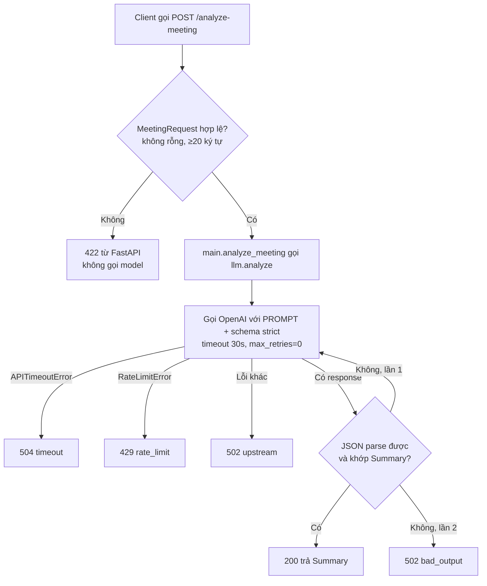

# W2 – Walkthrough: POST /analyze-meeting

Tài liệu này ghi lại những gì đã làm trong W2 tính đến ngày 25/11/2026, cách chạy, và kết quả đo được. Mọi số liệu đều lấy từ lần chạy đã thực hiện trong phiên làm việc này.

## 1. Mục tiêu và trạng thái

Yêu cầu GATE 1 (theo `documents/HUONG_DAN_AI_FAST_TRACK.md`, W2):
- Chạy được theo README, có `/docs`.
- 100% output thành công đúng schema.
- ≥ 17/20 case trích xuất đúng.
- 5/5 kịch bản lỗi pass.
- Không có API key trong Git hoặc log.

Trạng thái hiện tại:

| Yêu cầu | Trạng thái | Bằng chứng |
|---|---|---|
| `/docs` mở được | Đạt | HTTP 200 |
| 100% output đúng schema | Đạt trên bộ mentor | 20/20 response đúng schema |
| ≥ 17/20 case đúng | **Chưa đạt** | 15/20 |
| 5/5 kịch bản lỗi | Đạt | `tests/test_w2_errors.py`: 6 passed |
| Không lộ key | Chưa kiểm tra đầy đủ | Các lệnh đã chạy trong phiên không in giá trị key; chưa chạy `git status` để kiểm tra Git |
| Bộ 20 case tự làm (mục E) | **Chưa đạt** | Đang dùng bộ của mentor |

## 2. Những gì đã làm

| File | Nội dung |
|---|---|
| `app/schemas.py` | `MeetingRequest` (chuỗi sau khi strip, tối thiểu 20 ký tự), `Decision` (có trường `text`), `ActionItem` (`owner`, `action`, `due_date`, cho phép `None`), `Summary` (`summary`, `decisions`, `actions`) |
| `app/services/llm.py` | Hàm `analyze(text)`. Gọi OpenAI với structured output `strict`, timeout 30 giây, `max_retries=0`, thử tối đa 2 lần nếu JSON sai khuôn. Lỗi được chia thành 4 loại: `timeout`, `rate_limit`, `upstream`, `bad_output` |
| `app/main.py` | `POST /analyze-meeting`. Bảng map lỗi: timeout → 504, rate_limit → 429, upstream → 502, bad_output → 502 |
| `.env` | Thêm `W2_MODEL=gpt-6-luna`. `OPENAI_MODEL=gpt-4.1` vẫn giữ cho W1 |
| `tests/test_w2_errors.py` | 6 test: input sai (422, không gọi model), timeout (504), 429, upstream 500 (502), JSON hỏng (2 lần gọi rồi 502), response thành công khớp schema |
| `scripts/evaluate_w2_meetings.py` | Script chấm 20 case, ghi `evidence/w2/w2_eval.json` |
| `data/w2/meeting_cases.json` | Bộ 20 case do mentor cung cấp (không phải bộ tự làm) |

**Lý do chọn một số điểm:**
- `gpt-6-luna` trả HTTP 400 khi gửi `temperature=0` (chỉ chấp nhận giá trị mặc định 1), nên `llm.py` không đặt `temperature`.
- `decisions` là danh sách object `{"text": ...}` theo mục "Pydantic models: ... Decision ..." của hướng dẫn W2.
- Ngày tuyệt đối trong prompt được yêu cầu theo dạng `YYYY-MM-DD`. Ngày tương đối giữ nguyên chuỗi gốc.

## 3. Cách chạy

Lệnh dưới đây đã chạy thành công trong phiên này (không cần `source .env`):

**Cài đặt (lệnh chuẩn, chưa chạy lại trong phiên này):**
```
python3 -m venv .venv
.venv/bin/pip install -r requirements.txt
```

**Chạy server:**
```
env $(grep -E "^(OPENAI_API_KEY|OPENAI_BASE_URL|W2_MODEL)=" .env | xargs) .venv/bin/uvicorn app.main:app --port 8000
```
Mở `http://127.0.0.1:8000/docs` để xem API.

**Chạy test (không gọi API thật):**
```
.venv/bin/python -m pytest -q tests/test_w2_errors.py tests/test_mock_jira.py
```
Kết quả: `9 passed`.

**Chấm bộ 20 case (gọi API 20 lần):**
```
.venv/bin/python scripts/evaluate_w2_meetings.py
```

**Gọi thử một request:**
```
curl -X POST http://127.0.0.1:8000/analyze-meeting -H "Content-Type: application/json" -d '{"text": "Biên bản họp đủ dài để qua kiểm tra 20 ký tự."}'
```
Lệnh `curl` này chưa được chạy trong phiên. Lần gọi đã kiểm tra là TC01 qua `urllib`, HTTP 200.

## 4. Workflow

### 4.1. Một request tới `/analyze-meeting`



### 4.2. Bộ chấm

1. Đọc 20 case từ `data/w2/meeting_cases.json`.
2. Với mỗi case: gọi `analyze()`. Nếu lỗi, case bị tính là sai.
3. So `decisions` theo số lượng.
4. So `actions` theo số lượng, và mỗi action đáp án phải khớp một action của model ở cả `owner` (`None` khớp `None`) và `due_date` (chuỗi khớp chính xác).
5. `summary` và nội dung `action` không được chấm.
6. Ghi kết quả vào `evidence/w2/w2_eval.json` và in số case đạt, số đúng schema, cùng danh sách case sai kèm lý do.

### 4.3. Bộ test lỗi

Mỗi test thay `OpenAI` trong `app.services.llm` bằng một class giả. Class giả trả về response hoặc ném lỗi tùy kịch bản, nên test không gọi API thật.

## 5. Kết quả đo được

### 5.1. Bộ chấm trên 20 case mentor

Lệnh: `.venv/bin/python scripts/evaluate_w2_meetings.py`

Kết quả: **15/20 đạt, đúng schema 20/20, trạng thái FAIL** (cần ≥ 17).

| Case | Nhóm | Lý do sai | Đáp án | Model trả về |
|---|---|---|---|---|
| TC12 | Ambiguous | Ghi quyết định bị hoãn thành decision | 0 decision | 1 decision |
| TC13 | Ambiguous | Tạo action từ đề xuất | 1 action (Lan) | 2 action (thêm Phu, không có ngày) |
| TC15 | Complex | Gộp hai người thành một owner "Phu và Hung" | 5 action | 4 action |
| TC17 | Complex | Gộp hai quyết định thành một | 3 decision | 2 decision |
| TC20 | Edge cases | Tạo action từ suy đoán, `due_date` là "the next meeting" | 0 action | 2 action |

Các case còn lại đạt, gồm TC01–TC11, TC14, TC16, TC18, TC19.

### 5.2. Độ ổn định

Đã chạy TC01 ba lần qua `analyze()`. Cả ba lần đều có owner đúng (Phu, Hung, Minh) và `due_date` dạng `2026-11-25`, `2026-11-26`, `2026-11-27`. Nội dung `decisions` có cách diễn đạt khác nhau giữa các lần.

Bộ chấm chỉ chạy một lần trên 20 case, nên chưa đo được độ ổn định trên toàn bộ bộ case.

## 6. Hạn chế và việc còn lại

- Bộ 20 case đang dùng là của mentor. Mục E yêu cầu bộ tự làm, và mục này chưa đạt.
- Nếu sửa prompt theo quy tắc của các case lỗi trên rồi chạy lại trên chính bộ mentor, kết quả sẽ không còn là đánh giá độc lập.
- Các quy tắc cần bổ sung nếu chọn tinh chỉnh prompt: quyết định bị hoãn không phải decision; đề xuất không phải action; việc chung của nhiều người tách thành mỗi người một action; mỗi quyết định một dòng; suy đoán không phải action; không có ngày thì `null`.
- Chưa có README W2, chưa có `evidence/w2/` các ví dụ `curl` hoặc file `.http`.
- Checklist `timeline_checklist/w2.md` chưa được tick các mục C, D, F, G.
- Chưa có PR, chưa có video, chưa có báo cáo test theo mẫu.
