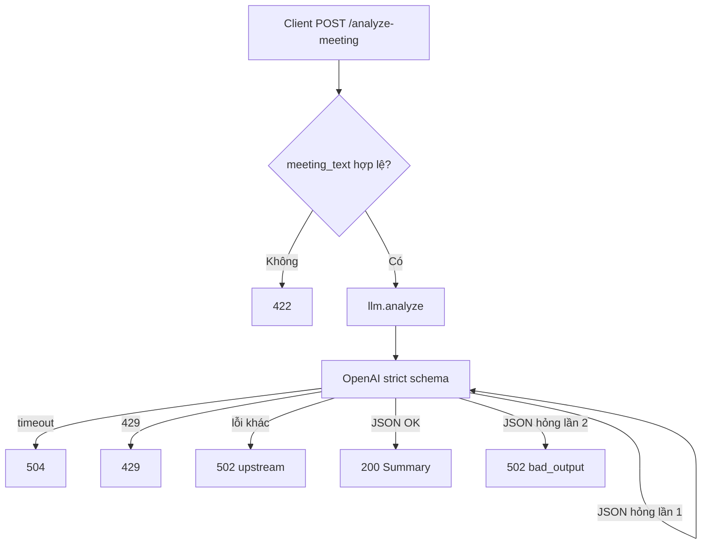

# W2 – Walkthrough: POST /analyze-meeting

Cập nhật: 26/11/2026. Số liệu từ `evidence/w2/w2_eval.json` (chạy `.venv/bin/python scripts/evaluate_w2_meetings.py`).

## 1. Mục tiêu và trạng thái GATE 1

| Yêu cầu | Trạng thái | Bằng chứng |
|---|---|---|
| Chạy theo README, có `/docs` | Đạt | `GET /docs` → 200; demo `/demo` |
| 100% output đúng schema | Đạt | 20/20 |
| ≥ 17/20 case trích xuất đúng | **Đạt** | **20/20** (`check()`) |
| 5/5 kịch bản lỗi | Đạt | `tests/test_w2_errors.py` → 6 passed |
| Không lộ API key | Kiểm tra cục bộ | `.env` gitignore; không commit key |
| Bộ 20 case tự làm (mục E) | Chưa đúng chữ guide | Đang dùng bộ mentor public |

Kết quả eval mới nhất: **PASS** — `Đạt 20/20 | đúng schema 20/20`. Không có case FAIL theo `check()`.

## 2. Những gì đã làm

| File | Nội dung |
|---|---|
| `app/schemas.py` | `MeetingRequest` (≥20 ký tự), `ActionItem`, `Summary` (`decisions: list[str]`) |
| `app/services/llm.py` | `analyze()` (structured output strict, timeout 30s, retry JSON ≤2); `judge_summary()` (so nghĩa summary, không tính Gate) |
| `app/main.py` | `POST /analyze-meeting`; `GET /demo`; `GET /demo-api/cases`; `POST /demo-api/compare`; `POST /demo-api/judge-summary` |
| `app/scoring.py` | `check()` — số decisions/actions + cặp `(owner, due_date)` |
| `app/static/demo.html` | Demo: Run → panel so sánh; Run all → bảng + popup Xem KQ; nút Chấm summary |
| `tests/test_w2_errors.py` | 6 test mock (422 / 504 / 429 / 502 / bad_output / schema) |
| `scripts/evaluate_w2_meetings.py` | 20 case: `analyze` + `check` only (`summary_judge: deferred`) |
| `data/w2/meeting_cases.json` | Bộ 20 case mentor (public development set) |
| Evidence | `w2_eval.json`, `w2_error_reasons.md`, `w2_pr_description.md`, `analyze_meeting.http` |

**Chốt đã áp dụng:**
- Provider OpenAI; model W2 qua `W2_MODEL` (ví dụ `gpt-6-luna`; không set `temperature=0` nếu model từ chối).
- Owner/ngày không rõ → `null`; ngày tương đối → `due_date = null`; ngày thiếu năm → lấy năm từ ngày họp.
- Decision: agreement của team (kể cả “needs improvement” / “is necessary”); không bịa từ “no decision” / postponed / proposal; dời hạn → một decision (không tách “hạn cũ hết hiệu lực”).
- HTTP: timeout 504, rate_limit 429, upstream 502, bad_output 502.

## 3. Cách chạy

Từ thư mục gốc repo:

```bash
.venv/bin/pip install -r requirements.txt
```

API + demo (cần `.env`: `OPENAI_API_KEY`, `OPENAI_BASE_URL`, `W2_MODEL`):

```bash
env $(grep -E "^(OPENAI_API_KEY|OPENAI_BASE_URL|W2_MODEL)=" .env | xargs) .venv/bin/uvicorn app.main:app --port 8000
```

- Docs: `http://127.0.0.1:8000/docs`
- Demo: `http://127.0.0.1:8000/demo`

Test:

```bash
.venv/bin/python -m pytest -q tests/test_w2_errors.py tests/test_mock_jira.py
.venv/bin/python scripts/smoke_test.py
```

Eval (~20 lượt analyze; không gọi summary judge):

```bash
.venv/bin/python scripts/evaluate_w2_meetings.py
```

Ví dụ HTTP: `evidence/w2/analyze_meeting.http` và README.

## 4. Workflow



**Demo**
1. Chọn case → chỉ load input (panel so sánh ẩn).
2. **Run** → `/analyze-meeting` → `/demo-api/compare` → hiện panel Gold | AI + PASS/FAIL.
3. **Chấm summary** (tuỳ chọn) → `/demo-api/judge-summary` → đúng nghĩa có/không; không đổi Gate.
4. **Run all** → bảng 20 case; **Xem KQ** mở popup so sánh.

## 5. Cách chấm (Gate)

- `decisions`: so **số lượng**.
- `actions`: số lượng + từng cặp `(owner, due_date)`.
- Nội dung chữ decision/action/`summary`: **không** tính vào `check()`.
- Summary judge: chỉ trên demo / API riêng; eval script ghi `summary_judge: deferred`.
- Gate: `passed >= 17` và `schema_ok == 20`.

## 6. Kết quả 20/20

Không có case FAIL. Predicted từng case: `evidence/w2/w2_eval.json`.  
Lịch sử lỗi đã hết (ví dụ TC16): xem `evidence/w2/w2_error_reasons.md`.

## 7. Việc còn lại để nộp

- (Tuỳ chọn) Mục E: bộ 20 case tự viết.
- Commit / push nhánh `w2`, mở PR theo `evidence/weekly_pr_template.md` (nháp: `w2_pr_description.md`).
- Video màn hình + gửi link PR cho mentor.
