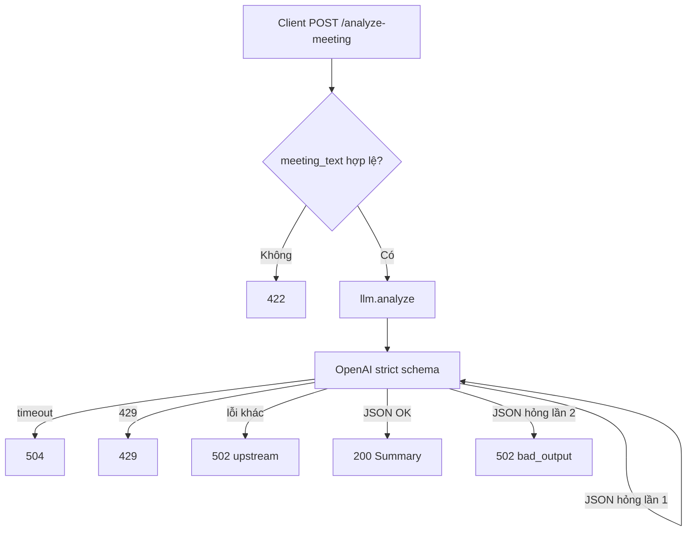

# W2 – Walkthrough: POST /analyze-meeting

Cập nhật: 26/11/2026. Số liệu lấy từ lần chạy `.venv/bin/python scripts/evaluate_w2_meetings.py` trong phiên này.

## 1. Mục tiêu và trạng thái GATE 1

| Yêu cầu | Trạng thái | Bằng chứng |
|---|---|---|
| Chạy theo README, có `/docs` | Đạt | `GET /docs` → 200; demo tại `/demo` |
| 100% output đúng schema | Đạt | 20/20 |
| ≥ 17/20 case trích xuất đúng | **Đạt** | **18/20** |
| 5/5 kịch bản lỗi | Đạt | `tests/test_w2_errors.py` → 6 passed |
| Không lộ API key | Kiểm tra cục bộ | `.env` bị gitignore; `git ls-files` không có `.env` |
| Bộ 20 case tự làm (mục E) | Chưa đạt đúng chữ | Đang dùng bộ mentor (public development set) |

Kết quả lần chạy mới nhất: **PASS** (`Đạt 18/20 | đúng schema 20/20`).

Case sai: **TC07**, **TC09** (model trả 0 decision trong khi đáp án có 1).

## 2. Những gì đã làm

| File | Nội dung |
|---|---|
| `app/schemas.py` | `MeetingRequest.meeting_text` (≥20 ký tự), `ActionItem`, `Summary` với `decisions: list[str]` theo đặc tả mentor |
| `app/services/llm.py` | `analyze()`; OpenAI structured output strict; timeout 30s; retry JSON tối đa 2 lần; đọc `W2_MODEL` |
| `app/main.py` | `POST /analyze-meeting`; map lỗi; `GET /demo`; `GET /demo-api/cases`; `POST /demo-api/compare` |
| `app/scoring.py` | Hàm `check()` dùng chung cho script eval và demo |
| `app/static/demo.html` | UI demo: chọn case, Run, đáp án sau Run, so sánh, Run all |
| `tests/test_w2_errors.py` | 6 test mock (422/504/429/502/bad_output/schema) |
| `scripts/evaluate_w2_meetings.py` | Chấm 20 case + judge summary (báo cáo riêng) |
| `data/w2/meeting_cases.json` | Bộ 20 case mentor |
| `.env` | `W2_MODEL=gpt-6-luna` (không commit) |

**Chốt đã áp dụng:**
- Provider: OpenAI. Model W2: `gpt-6-luna` (không đặt `temperature=0` vì model từ chối).
- Ngày tương đối → `due_date = null`.
- Ngày không có năm → lấy năm từ ngày họp.
- Mã lỗi: timeout 504, rate_limit 429, upstream 502, bad_output 502.

## 3. Cách chạy

Từ thư mục gốc repo:

```bash
cd /home/tthanhphung/projects/anothor_ptojects/ai-delivery-assistant
.venv/bin/pip install -r requirements.txt
```

Chạy API + demo:
```bash
env $(grep -E "^(OPENAI_API_KEY|OPENAI_BASE_URL|W2_MODEL)=" .env | xargs) .venv/bin/uvicorn app.main:app --port 8000
```
- Docs: `http://127.0.0.1:8000/docs`
- Demo: `http://127.0.0.1:8000/demo`

Test:
```bash
.venv/bin/python -m pytest -q tests/test_w2_errors.py tests/test_mock_jira.py
.venv/bin/python scripts/smoke_test.py
```

Eval (40 lượt API: 20 analyze + 20 judge):
```bash
.venv/bin/python scripts/evaluate_w2_meetings.py
```

Ví dụ curl: `evidence/w2/analyze_meeting.http` và lệnh trong README.

## 4. Workflow



Demo: chọn case → Run → `/analyze-meeting` → `/demo-api/compare` → hiện đáp án + ĐẠT/SAI.  
Run all: lặp 20 case, bảng tổng điểm.

## 5. Cách chấm

- `decisions`: so **số lượng**.
- `actions`: so số lượng + từng cặp `(owner, due_date)` khớp chính xác.
- `summary`: không tính vào đạt/không đạt; judge nghĩa báo cáo riêng (`summary_ok`).
- Gate script: `passed >= 17` và `schema_ok == 20`.

## 6. Kết quả 18/20

| Case | Lý do |
|---|---|
| TC07 | Đáp án 1 decision ("Improve the API documentation."), model 0 decision; action owner=null và due_date đúng |
| TC09 | Đáp án 1 decision (đồng ý refactor là cần thiết), model 0 decision; không có action (đúng) |

Summary judge: 9/20 (dao động giữa các lần; không tính vào PASS).

## 7. Việc còn lại để nộp

- Mục E: bộ 20 case **tự viết** (hiện dùng bộ mentor).
- Push nhánh `w2` (lỗi 403 trước đó: tài khoản `tthanhphung` không có quyền ghi repo `phungtran98/...`).
- PR theo `evidence/weekly_pr_template.md`, video demo, gửi mentor.
