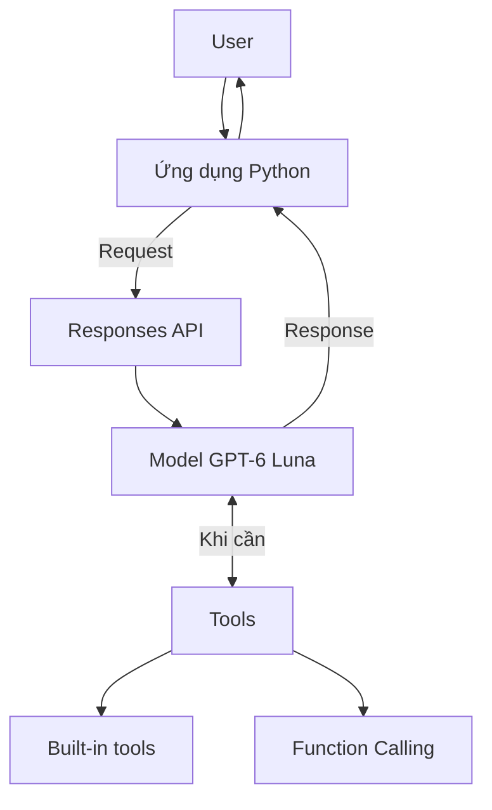
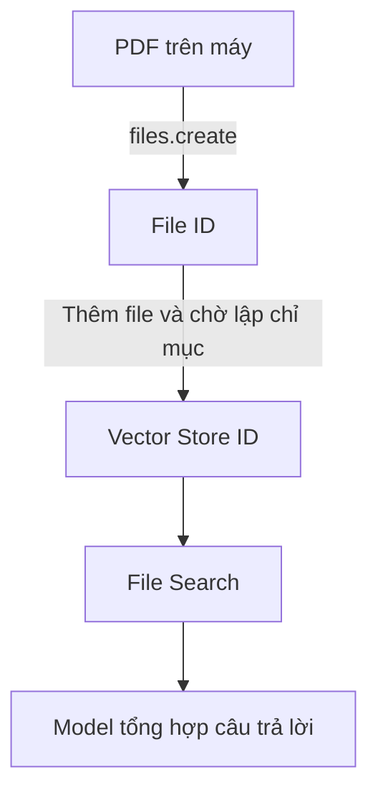
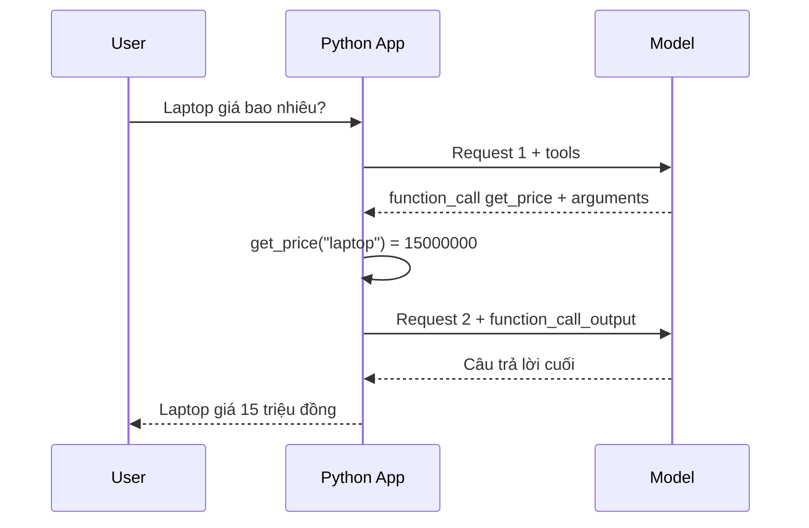

# Tổng kết buổi học OpenAI API – Developer Quickstart

**Ngày học:** 24/11/2026 · **Ngôn ngữ:** Python · **Model thống nhất:** `gpt-6-luna`

Mục tiêu: hiểu cách gọi Responses API, mở rộng khả năng của model bằng tools, nhận phản hồi streaming và nắm nền tảng AI Agent. Nội dung ưu tiên cách giải thích dễ nhớ để ôn tập và trình bày với sếp.

## 1. Quy tắc học tập đã thống nhất

- Không đoán bừa (assumption); nếu chưa chắc, nói rõ và đối chiếu tài liệu chính thức.
- Hiểu cơ chế trước khi học thuộc cú pháp. Thực hành bằng VS Code, sau đó tự diễn giải lại.
- Dùng `gpt-6-luna` thống nhất trong các ví dụ. Đây là model ID được tài liệu chính thức xác nhận tại thời điểm tổng kết.
- Không chia sẻ API key; lưu trong biến môi trường. Kiểm tra quyền truy cập model và chi phí trước khi chạy.
- Phân biệt kết quả đã quan sát trong buổi học với kết quả minh họa. Những ví dụ dưới đây được soạn để chạy với SDK phù hợp; không phải tất cả đã được chạy thử bằng tài khoản của bạn.

## 2. Các khái niệm nền tảng

| Thuật ngữ | Cách nhớ | Ý nghĩa |
|---|---|---|
| Model | Bộ não | Xử lý input, suy luận, sinh phản hồi và có thể lựa chọn tool |
| API | Cầu nối | Giao diện để ứng dụng gửi yêu cầu đến dịch vụ và nhận kết quả |
| Prompt / Input | Yêu cầu | Nội dung hoặc nhiệm vụ được đưa vào model |
| Instructions | Bộ chỉ dẫn | Định hướng vai trò, cách xử lý, phong cách và quy tắc |
| Tools | Bộ công cụ | Mở rộng khả năng của model, chẳng hạn tìm kiếm hay gọi hàm |
| Tool choice | Quy tắc dùng công cụ | Điều khiển việc model có được hoặc phải gọi tool |
| Response | Phản hồi | Đối tượng kết quả từ API, không phải tham số gửi đi |
| Agent | Hệ thống thực hiện nhiệm vụ | Dùng model, chỉ dẫn, công cụ và vòng lặp điều phối để hướng tới mục tiêu |



## 3. Bắt đầu với Responses API

Cài hoặc cập nhật SDK trong Terminal của VS Code:

```bash
python -m pip install -U openai
```

Thiết lập biến môi trường `OPENAI_API_KEY` trên máy. Ví dụ PowerShell (chỉ nhập key thật trong máy của bạn):

```powershell
$env:OPENAI_API_KEY = "YOUR_API_KEY"
```

Tạo `hello.py`:

```python
from openai import OpenAI

client = OpenAI()
response = client.responses.create(
    model="gpt-6-luna",
    input="Giải thích AI là gì trong 3 câu."
)
print(response.output_text)
```

`client.responses.create()` gửi request. `response.output_text` là tiện ích SDK lấy nội dung văn bản; `response.output` chứa các mục đầu ra có cấu trúc, bao gồm cả tool call nếu có.

## 4. Tools và Tool Choice

### Hai nhóm công cụ đã học

| Built-in tools (OpenAI cung cấp) | Function Calling (hàm tự định nghĩa) |
|---|---|
| Web Search: tìm thông tin trên web | Tra cứu database |
| File Search: truy xuất thông tin trong tài liệu đã lập chỉ mục | Kiểm tra giá, tồn kho, đơn hàng |
| Code Interpreter: viết và chạy Python trong sandbox | Gửi email qua hệ thống của mình (cần kiểm soát quyền) |

Có thể khai báo nhiều tools trong một list, nếu model và cấu hình hỗ trợ. Model có thể không dùng, dùng một hoặc nhiều công cụ tùy nhiệm vụ và `tool_choice`.

| `tool_choice` | Ý nghĩa |
|---|---|
| `"auto"` | Model có thể tự chọn dùng hoặc không dùng tool |
| `"required"` | Bắt buộc gọi ít nhất một tool; nếu chỉ khai báo một tool, đó là tool phải dùng |
| `"none"` | Không cho gọi tool |

`required` không có nghĩa là phải gọi tất cả các tools, cũng không đảm bảo tool thực thi thành công.

Ví dụ khai báo hai tools:

```python
from openai import OpenAI
client = OpenAI()
response = client.responses.create(
    model="gpt-6-luna",
    tools=[
        {"type": "web_search"},
        {"type": "code_interpreter", "container": {"type": "auto"}}
    ],
    tool_choice="auto",
    input="Tìm một số liệu công khai mới và tính 10% của số liệu đó. Nêu nguồn."
)
print(response.output_text)
```

## 5. Web Search

Dùng khi cần thông tin mới, nguồn công khai hoặc tra cứu bên ngoài kiến thức sẵn có của model.

```python
from openai import OpenAI
client = OpenAI()
response = client.responses.create(
    model="gpt-6-luna",
    tools=[{"type": "web_search"}],
    tool_choice="required",
    input="Tìm một tin tích cực hôm nay và nêu nguồn."
)
print(response.output_text)
```

Tip: kiểm tra nguồn và ngày xuất bản; nếu xây dựng UI, giữ các chú thích nguồn từ response để người dùng có thể mở và kiểm chứng. Có web search không đồng nghĩa với mọi thông tin đều chính xác.

## 6. File Search – tìm kiếm trong tài liệu

### Luồng hoạt động



Python mở file local rồi upload qua Files API; không phải upload thủ công trên web. Model trên máy chủ không tự đọc được đường dẫn file trên máy bạn. Vector Store là kho được xử lý và lập chỉ mục để hỗ trợ truy xuất theo nội dung và từ khóa.

### Ví dụ `file_search.py`

Đặt `document.pdf` trong thư mục chạy chương trình.

```python
from openai import OpenAI
client = OpenAI()

with open("document.pdf", "rb") as f:
    file = client.files.create(file=f, purpose="assistants")

vector_store = client.vector_stores.create(name="My Documents")
result = client.vector_stores.files.create_and_poll(
    vector_store_id=vector_store.id,
    file_id=file.id
)
if result.status != "completed":
    raise RuntimeError(result.status)

print("File ID:", file.id)
print("Vector Store ID:", vector_store.id)

response = client.responses.create(
    model="gpt-6-luna",
    tools=[{"type": "file_search", "vector_store_ids": [vector_store.id]}],
    tool_choice="required",
    input="Tóm tắt những nội dung chính của tài liệu bằng tiếng Việt."
)
print(response.output_text)
```

| Thuật ngữ | Ý nghĩa |
|---|---|
| `file.id` | ID của file đã upload |
| `vector_store.id` | ID của kho tìm kiếm |
| `create_and_poll()` | Thêm file và chờ xử lý hoàn tất |
| `vector_store_ids` | Danh sách kho mà tool có thể tìm kiếm |

Tip: lưu lại Vector Store ID để tái sử dụng; không cần tạo kho và upload lại cho mỗi câu hỏi. Kiểm tra chính sách dữ liệu và xóa file/kho khi không còn cần thiết; có thể phát sinh phí lưu trữ.

### Cách khác: File Input trực tiếp

Nếu chỉ muốn tóm tắt toàn bộ một PDF nhỏ/vừa, có thể truyền file trực tiếp mà không tạo Vector Store.

```python
from openai import OpenAI
client = OpenAI()
with open("document.pdf", "rb") as f:
    file = client.files.create(file=f, purpose="user_data")

response = client.responses.create(
    model="gpt-6-luna",
    input=[{"role": "user", "content": [
        {"type": "input_file", "file_id": file.id},
        {"type": "input_text", "text": "Tóm tắt tài liệu bằng tiếng Việt."}
    ]}]
)
print(response.output_text)
```

File Search phù hợp hỏi đáp, tìm thông tin liên quan trong kho tài liệu. File Input phù hợp đọc trực tiếp tài liệu trong giới hạn dung lượng/context. File Search có thể bỏ sót phần không được truy xuất nếu yêu cầu tóm tắt toàn bộ.

## 7. Code Interpreter – thực thi Python

Model có thể viết code Python và chạy trong môi trường sandbox do OpenAI quản lý, ví dụ tính toán, phân tích CSV, tạo biểu đồ.

### Ví dụ `code_interpreter.py` (đã thực hành phép nhân trong buổi học)

```python
from openai import OpenAI
client = OpenAI()
response = client.responses.create(
    model="gpt-6-luna",
    tools=[{"type": "code_interpreter", "container": {"type": "auto"}}],
    tool_choice="required",
    input="Dùng Python tính 17 * 23."
)
print(response.output_text)
for item in response.output:
    if item.type == "code_interpreter_call":
        print("Code:", item.code)
        print("Container ID:", item.container_id)
        print("Status:", item.status)
```

Kết quả phép tính đã quan sát: **391**. Chỉ nhìn kết quả 391 không đủ để xác nhận tool đã chạy; hãy kiểm tra `code_interpreter_call` và trạng thái.

| Khái niệm | Phân biệt |
|---|---|
| `container.type = "auto"` | Tự động tạo hoặc sử dụng lại môi trường chạy code phù hợp |
| `tool_choice = "auto"` | Model tự quyết định có cần gọi tool không |
| `tool_choice = "required"` | Bắt buộc có tool call (không bảo đảm thực thi thành công) |

### Ví dụ đọc CSV và tính doanh thu

Tạo file `sales.csv` minh họa:

```csv
product,revenue
laptop,15000000
phone,8000000
monitor,14000000
```

```python
from openai import OpenAI
client = OpenAI()
with open("sales.csv", "rb") as f:
    file = client.files.create(file=f, purpose="user_data")

response = client.responses.create(
    model="gpt-6-luna",
    tools=[{"type": "code_interpreter", "container": {
        "type": "auto", "file_ids": [file.id]
    }}],
    tool_choice="required",
    input="Đọc sales.csv bằng Python, tính tổng cột revenue theo VND."
)
print(response.output_text)
```

Với dữ liệu CSV minh họa trên, tổng mong đợi là 37.000.000 VND. Code Interpreter không tự truy cập file local; cần cung cấp file cho container.

## 8. Instructions – bộ chỉ dẫn

**Câu đã chốt:** Instructions là tham số dùng để chỉ dẫn AI về vai trò, cách xử lý nhiệm vụ, phong cách trả lời và các quy tắc cần tuân thủ.

```python
from openai import OpenAI
client = OpenAI()
response = client.responses.create(
    model="gpt-6-luna",
    instructions="""Bạn là chuyên gia AI.
Giải thích dễ hiểu cho người mới học bằng tiếng Việt.
Không đoán bừa; nói rõ nếu chưa chắc chắn.
Đưa ví dụ ngắn gọn.""",
    input="File Search là gì?"
)
print(response.output_text)
```

- `instructions`: cách AI nên làm nhiệm vụ; thường do developer thiết lập.
- `input`: nhiệm vụ cụ thể được giao.
- Instructions không phải tool; là tham số của request, giống `model`, `tools`, `tool_choice`, `input`, `stream`.
- Instructions có ưu tiên cao hơn yêu cầu thông thường của user, nhưng không bảo đảm model tuân thủ tuyệt đối; các kiểm tra an toàn cần thực hiện bằng code.
- Khi nối request qua `previous_response_id`, top-level `instructions` trước đó không tự động được chuyển tiếp; truyền lại nếu cần.

## 9. Function Calling – phần quan trọng đã chạy thành công

**Câu đã chốt bằng lời của bạn: AI quyết định gọi hàm, Python thực thi hàm.**

Khác với Code Interpreter chạy Python do model tạo trong sandbox, Function Calling cho phép model yêu cầu ứng dụng gọi các hàm mà lập trình viên tự triển khai. Với ví dụ này, chương trình local thực thi hàm.



### Code `function_calling.py`

```python
from openai import OpenAI
import json
client = OpenAI()

def get_price(product):
    prices = {"laptop": 15000000, "phone": 8000000}
    return prices.get(product.lower(), "Không tìm thấy")

tools = [{
    "type": "function",
    "name": "get_price",
    "description": "Tra cứu giá sản phẩm bằng VND",
    "parameters": {
        "type": "object",
        "properties": {
            "product": {"type": "string", "description": "Tên sản phẩm"}
        },
        "required": ["product"],
        "additionalProperties": False
    },
    "strict": True
}]

# Request 1: nhận yêu cầu gọi hàm
response = client.responses.create(
    model="gpt-6-luna", tools=tools, tool_choice="required",
    input="Laptop giá bao nhiêu?"
)

# Thực thi hàm trong ứng dụng
outputs = []
for item in response.output:
    if item.type == "function_call" and item.name == "get_price":
        args = json.loads(item.arguments)
        result = get_price(args["product"])
        print("Function:", item.name)
        print("Arguments:", args)
        print("Result:", result)
        outputs.append({
            "type": "function_call_output",
            "call_id": item.call_id,
            "output": str(result)
        })

if not outputs:
    raise RuntimeError("Không nhận được function call phù hợp")

# Request 2: gửi kết quả về model
final_response = client.responses.create(
    model="gpt-6-luna", previous_response_id=response.id,
    input=outputs, tools=tools, tool_choice="none"
)
print("AI Response:", final_response.output_text)
```

Kết quả đã xác nhận trong buổi học: có tên hàm `get_price`, đối số `laptop` và kết quả 15 triệu. Câu trả lời cuối có thể khác cách diễn đạt.

### Parameters và Arguments

| Thuật ngữ | Ý nghĩa |
|---|---|
| `name` | Tên hàm được khai báo |
| `description` | Giải thích cho model biết khi nào nên gọi hàm |
| `parameters` | JSON Schema mô tả dữ liệu đầu vào |
| `properties` | Các trường đầu vào và kiểu dữ liệu |
| `required` | Các trường bắt buộc trong schema (khác với `tool_choice="required"`) |
| `strict` | Ràng buộc arguments tuân thủ schema |
| `arguments` | Dữ liệu cụ thể model sinh ra để gọi hàm |
| `json.loads()` | Chuyển chuỗi JSON thành đối tượng Python, ở đây là dictionary |
| `call_id` | Liên kết kết quả thực thi với lần gọi tương ứng |
| `function_call_output` | Mục input chứa kết quả hàm gửi lại model |
| `previous_response_id` | Liên kết với response trước |

Lưu ý: ví dụ có hai request vì chỉ xử lý một vòng gọi hàm. Các nhiệm vụ phức tạp có thể cần nhiều vòng hoặc nhiều tool calls. Kiểm tra đối số, quyền truy cập, lỗi thực thi và xác nhận của người dùng trước hành động nhạy cảm như gửi email hoặc ghi database. Không thực thi tên hàm/code tùy ý do model sinh ra.

### Lỗi đã gặp khi thực hành

- Thiếu `import json`: có thể gây `NameError` khi gọi `json.loads()`. Đây là thư viện chuẩn Python, không cần pip install.
- Kết nối gián đoạn khi đổi mạng: bạn đã chạy lại thành công. Nếu bị treo, có thể dừng bằng Ctrl+C và thử lại; nếu lỗi tiếp diễn, đọc đúng exception để xác định nguyên nhân. Không khẳng định mọi lỗi API đều do mạng.

## 10. Streaming – nhận phản hồi từng phần

**Câu đã chốt bằng lời của bạn:** Kiểu bình thường trả toàn bộ câu trả lời một lượt; streaming trả từng phần, từng phần trong lúc AI đang tạo nội dung.

```text
Non-streaming: [Đợi model tạo nội dung ........] → [Nhận toàn bộ]
Streaming:     [Đoạn 1] → [Đoạn 2] → [Đoạn 3] → [Hoàn tất]
```

### Ví dụ `streaming.py` (đã chạy và thấy chữ hiện dần)

```python
from openai import OpenAI
client = OpenAI()
stream = client.responses.create(
    model="gpt-6-luna",
    input="Giải thích AI là gì trong khoảng 200 từ.",
    stream=True
)
for event in stream:
    if event.type == "response.output_text.delta":
        print(event.delta, end="", flush=True)
print()
```

| Cú pháp | Ý nghĩa |
|---|---|
| `stream=True` | Bật chế độ nhận sự kiện theo luồng |
| `event` | Sự kiện từ API |
| `response.output_text.delta` | Sự kiện chứa đoạn văn bản mới |
| `event.delta` | Phần nội dung mới |
| `end=""` | Không tự xuống dòng sau mỗi lần print |
| `flush=True` | Đẩy nội dung ra ngay, không giữ trong bộ đệm print |

Streaming không phải tool. Nó giảm thời gian người dùng phải đợi để thấy phần nội dung đầu tiên so với nhận cả phản hồi, nhưng không bảo đảm giảm thời gian xử lý toàn bộ. Ứng dụng thực tế nên xử lý thêm sự kiện hoàn tất và lỗi.

## 11. AI Agent – nền tảng

**Câu đã chốt bằng lời của bạn:** AI Agent là một hệ thống sử dụng AI để thực hiện nhiệm vụ, có khả năng lựa chọn công cụ, xử lý kết quả và phối hợp nhiều bước để hoàn thành mục tiêu.

Ba thành phần cơ bản dễ nhớ: Model (bộ não), Instructions (bộ chỉ dẫn), Tools (bộ công cụ). Một hệ thống Agent thực tế còn cần cơ chế điều phối, quản lý trạng thái, điều kiện dừng và kiểm soát quyền/an toàn.

Ví dụ: Người dùng hỏi mua 2 laptop. Agent có thể tra giá 15 triệu, kiểm tra tồn kho còn 5 chiếc rồi tính tổng 30 triệu và báo lại. Đây là ví dụ minh họa, không phải dữ liệu cửa hàng thực.

### OpenAI Agents SDK

Thư viện hỗ trợ quản lý vòng lặp gọi model, thực thi tools và đưa kết quả về model. Không bắt buộc dùng SDK mới xây được Agent.

```bash
python -m pip install -U openai-agents
```

`ai_agent.py` (ví dụ để luyện thêm):

```python
import asyncio
from agents import Agent, Runner, function_tool

@function_tool
def get_price(product: str) -> str:
    """Tra cứu giá sản phẩm bằng VND."""
    prices = {"laptop": 15000000, "phone": 8000000}
    return str(prices.get(product.lower(), "Không tìm thấy"))

agent = Agent(
    name="Sales Assistant",
    model="gpt-6-luna",
    instructions="Bạn là nhân viên bán hàng. Dùng get_price để tra giá. Trả lời tiếng Việt.",
    tools=[get_price]
)

async def main():
    result = await Runner.run(agent, "Laptop giá bao nhiêu?")
    print(result.final_output)

asyncio.run(main())
```

| Function Calling thủ công | Agents SDK |
|---|---|
| Tự khai báo JSON Schema | `@function_tool` hỗ trợ tạo schema |
| Tự giải mã arguments, gọi hàm | SDK hỗ trợ điều phối |
| Tự gửi function call output | SDK quản lý vòng lặp |
| `response.output_text` | `result.final_output` |

SDK không thay thế việc lập trình viên phải viết logic nghiệp vụ, kiểm tra quyền và kiểm soát tác động thực tế.

## 12. Bảng ôn nhanh trước khi trình bày với sếp

| Câu hỏi | Câu trả lời ngắn |
|---|---|
| Model và API khác gì? | Model xử lý yêu cầu; API là giao diện để ứng dụng giao tiếp với dịch vụ. |
| Built-in tools khác Function Calling? | Built-in do OpenAI cung cấp; function do mình triển khai, AI yêu cầu gọi. |
| Có thể truyền nhiều tools không? | Có, `tools` là list; model lựa chọn theo cấu hình và nhiệm vụ. |
| `tool_choice` và container auto khác gì? | Một cái điều khiển gọi tool; một cái quản lý môi trường chạy code. |
| File Search nhận File ID hay Vector Store ID? | Tool nhận Vector Store ID; File ID dùng để đưa file vào kho. |
| Instructions khác Input? | Instructions quy định cách làm; Input giao nhiệm vụ. |
| Ai thực thi function tự viết? | Chương trình của mình hoặc hệ thống thực thi do mình tích hợp. |
| Streaming có giúp AI suy nghĩ nhanh hơn không? | Không nhất thiết; giúp nhận nội dung sớm và từng phần. |
| AI Agent khác Model? | Agent là hệ thống điều phối model, chỉ dẫn và tools để hoàn thành nhiệm vụ. |

### Đoạn trình bày ngắn

> OpenAI API cho phép ứng dụng của mình giao tiếp với AI model. Mình sử dụng GPT-6 Luna và Responses API. Model giống như bộ não, Instructions là bộ chỉ dẫn và Tools là bộ công cụ. OpenAI có các built-in tools như Web Search, File Search và Code Interpreter. Ngoài ra, mình có thể định nghĩa function riêng. Với Function Calling, AI quyết định gọi hàm, còn chương trình của mình thực thi hàm rồi gửi kết quả lại cho AI. Streaming giúp nhận câu trả lời từng phần thay vì đợi toàn bộ. AI Agent kết hợp model, instructions, tools và cơ chế điều phối để hoàn thành nhiệm vụ qua nhiều bước.

### Trạng thái học tập

- [x] Hiểu model, API, input, response, tools, tool choice, instructions.
- [x] Hiểu cách upload file, File ID, Vector Store và File Search.
- [x] Chạy ví dụ Code Interpreter: phép tính 17 × 23 = 391.
- [x] Chạy Function Calling: laptop giá 15 triệu, có tên hàm và arguments.
- [x] Chạy Streaming: thấy văn bản hiện dần.
- [x] Hiểu khái niệm AI Agent.
- [ ] Thực hành thêm File Search, CSV, Agents SDK nếu cần.
- [ ] Remote MCP, Webhooks và các chủ đề nâng cao: để buổi sau.

## 13. Tài liệu chính thức để tra cứu

- [Developer Quickstart](https://developers.openai.com/api/docs/quickstart)
- [GPT-6 Luna](https://developers.openai.com/api/docs/models/gpt-6-luna)
- [Responses API](https://developers.openai.com/api/reference/responses/overview)
- [Using tools](https://developers.openai.com/api/docs/guides/tools)
- [Web Search](https://developers.openai.com/api/docs/guides/tools-web-search)
- [File Search](https://developers.openai.com/api/docs/guides/tools-file-search)
- [File Inputs](https://developers.openai.com/api/docs/guides/file-inputs)
- [Code Interpreter](https://developers.openai.com/api/docs/guides/tools-code-interpreter)
- [Function Calling](https://developers.openai.com/api/docs/guides/function-calling)
- [Streaming](https://developers.openai.com/api/docs/guides/streaming-responses)
- [Agents SDK Quickstart](https://developers.openai.com/api/docs/guides/agents/quickstart)

Tài liệu và SDK có thể cập nhật. Khi gặp lỗi, ưu tiên kiểm tra phiên bản SDK, model ID, quyền truy cập, schema request và thông báo lỗi cụ thể.
